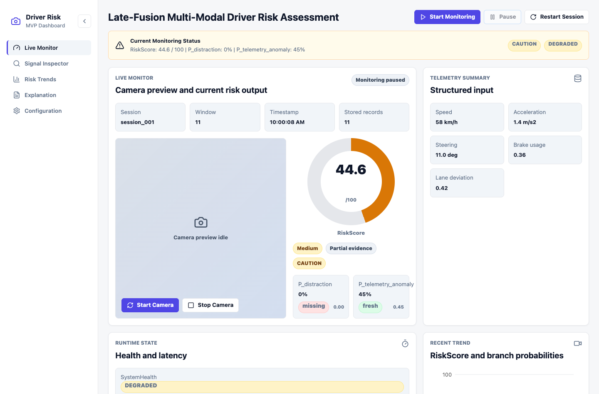
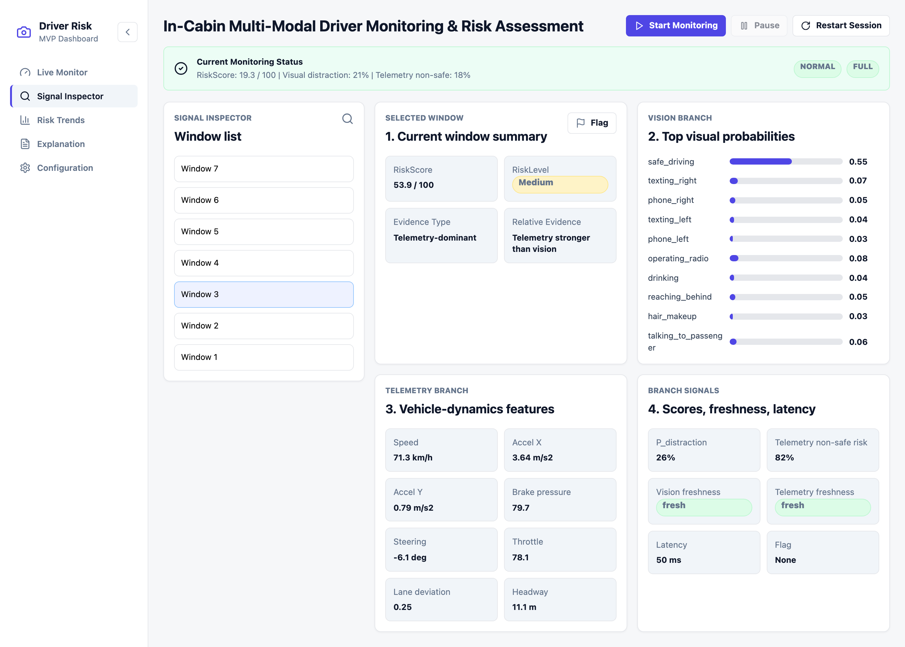
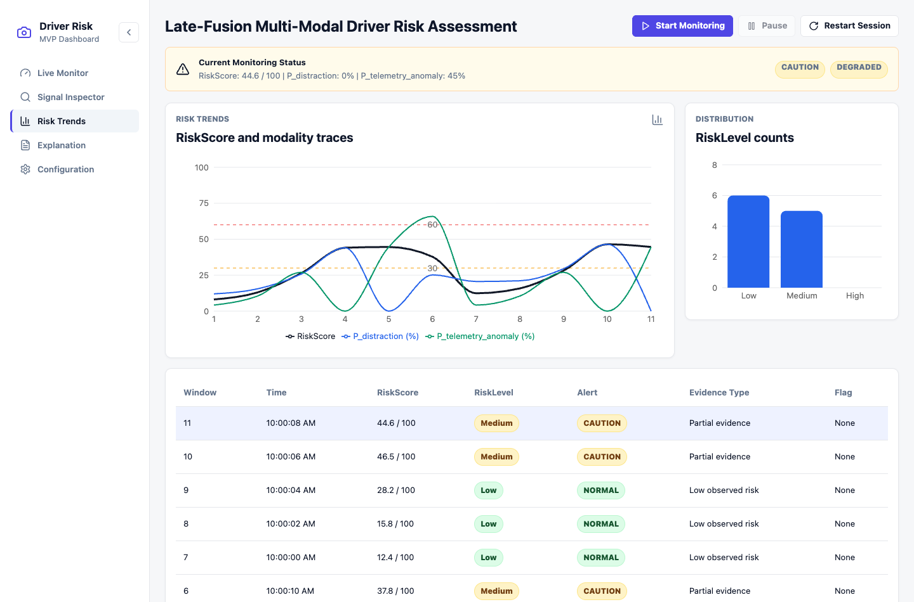
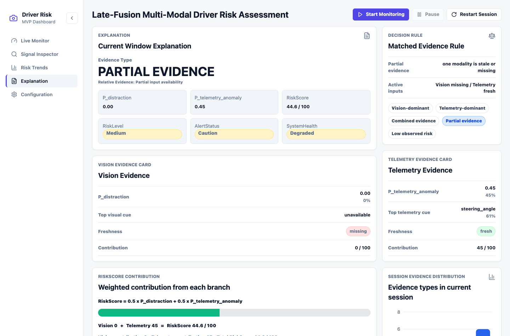
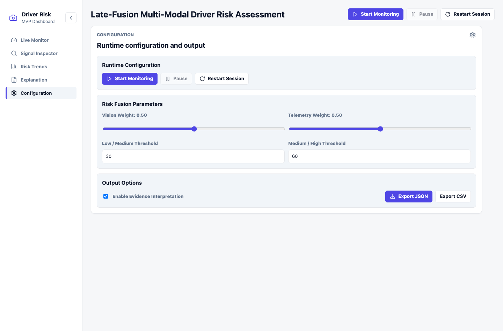

# In-Cabin Multi-Modal Driver Monitoring & Risk Assessment

React/TypeScript + FastAPI/SQLite research prototype with **live camera inference
using the existing trained MobileNetV3-Large ONNX model** and **prepared telemetry
replay through the trained XGBoost model**. Only the camera is a live sensor.

The backend owns EMA, freshness-aware late fusion, sustained alerts, session
state and persistence. The five dashboard views consume those saved results.
Prepared-probability demo mode remains a separate, explicitly labelled option.

## Run the complete system

From the repository root, using the existing environment and local trained
artifacts in `ml/outputs/` (no alternate model download required):

```bash
# Install only if dependencies are missing:
.venv/bin/python -m pip install -r backend/requirements-inference.txt
npm ci

# Build and serve UI + API on one localhost origin:
npm run build
.venv/bin/python -m uvicorn app.main:app --app-dir backend --host 127.0.0.1 --port 8000
```

Open http://127.0.0.1:8000, select **Live trained models**, click **Start
Monitoring**, and allow camera access. For development, run the same backend on
8000 and `npm run dev` separately; Vite proxies `/api` to it.

- [Runtime guide, inputs and limitations (中文)](docs/LIVE_RUNTIME_GUIDE.zh.md)
- [Completed work, verified tests and next steps (中文)](docs/IMPLEMENTATION_PROGRESS.zh.md)
- [Initial audit and accuracy/edge experiment plan (中文)](docs/PROJECT_ASSESSMENT_AND_TEST_PLAN.zh.md)
- [Backend API and persistence](backend/README.md)
- [Browser/frontend evidence](docs/evidence/2026-10-05/) and [final backend/HTTP evidence](docs/evidence/2026-10-09/)

The default target is 10 inference requests/second with one request in flight;
camera capture requests 30 FPS. Neither setting guarantees achieved throughput.
Frontal-camera accuracy and target edge hardware remain to be measured. Existing
source-dataset results are not field validation. Additional model experiments
are paused at the user's request.

## Repository

```text
frontend/       React views, camera capture, API client, live/replay controllers
backend/        FastAPI, trained ONNX/XGBoost provider, fusion/FSM, SQLite, exports
ai/             Shared TypeScript contract and demo/reference risk logic
ml/             Training notebooks, existing artifacts, reproducible experiments
docs/           Runtime guide, progress, initial assessment and measured evidence
prototype-tests/ Manual prototype checks
```

## Checks

```bash
npm test
npm run linc
npm run build
PYTHONPATH=backend .venv/bin/python -m pytest backend/tests -q
```

The full backend suite uses the local trained artifacts. The preprocessing parity
check additionally needs the existing training environment's torch/torchvision;
those libraries are not required for online serving. Browser evidence uses a
simulated camera with real model execution and a separate temporary database.

The screenshots below show the earlier prepared-demo layout; current runtime
screenshots are in [output/playwright](output/playwright/).

## Interface Screenshots

### Live Monitor

Displays the current monitoring window, fused risk score, branch probabilities,
alert status, system health, latency, and recent trend.



### Signal Inspector

Supports window-level review of historical monitoring records, including visual
evidence, telemetry features, freshness, latency, and flag status.



### Risk Trends

Shows session-level risk progression, branch probability traces, risk-level
distribution, and historical records.



### Explanation

Explains the current risk output using matched evidence rules, branch evidence,
and weighted contribution breakdown.



### Configuration

Provides runtime controls for monitoring, fusion weights, risk thresholds,
evidence interpretation export, and JSON/CSV session log export.


