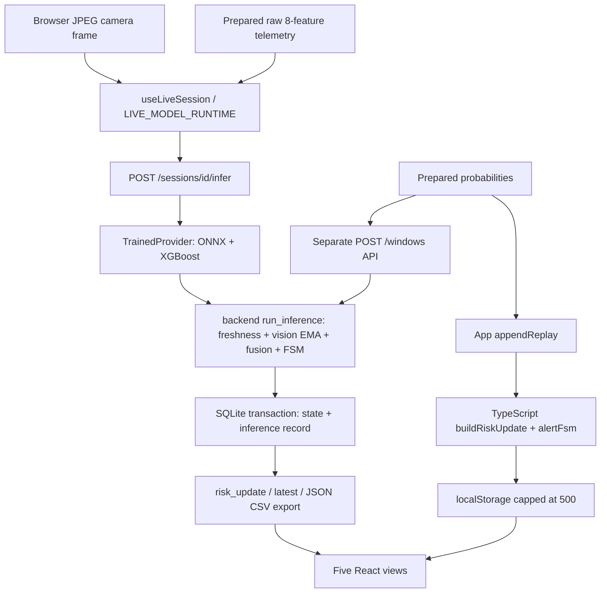

# Module and Architecture Inventory

> 审计日期：2026-10-10（Asia/Kuala_Lumpur）；实跑检查时间见各 evidence 日志（主要为 2026-10-09）。审计对象是用户确认的桌面主仓库 `/Users/liu/Desktop/FYP-In-Cabin-Driver-Assessment--1`，branch `dev_cc`，HEAD `17c4b41bcfe517c8311b7f6fc2a327f616a916fe` **加未提交内容**。本文所有应用源码相对路径都相对此根目录，不相对当前旧工作树。输出工作树 HEAD `ae550415237fc1f67bf0de50c643a6d8bd6aca60`。命令 ID、环境、时间、退出码、指纹见 [07 证据索引](07_EVIDENCE_MANIFEST.md) 与 [source inventory](evidence/source_inventory.json)。

证据层次：`CURRENT_VERIFIED`=本次源码/产物检查或明确限定范围的实跑；`FYP1_REPORTED`=未在本次对应范围复现的继承指标；`PLANNED`=建议，未执行。旧实验日志标明 historical，不算本次运行。实现状态与测试执行状态分别记录；`MISSING_TEST` 是测试缺口标记，不是实现状态。未发现只适用于已扫描范围。

## 实际路径与 source of truth

Live authority: backend `backend/app/routers/windows.py:86–108` → `backend/app/inference.py:21–73`; React stores response directly (`useLiveSession.ts:150–179`). Frontend replay authority: `App.tsx:50–79` computes locally, `utils/persistence.ts:42–51` caps local storage. The API replay endpoint exists, but the normal browser replay does **not** invoke it. Thus W2's exact React↔FastAPI replay skeleton is not proven by separate replay and API tests. UI explanation contributions still use TS helpers, so parity matters even with a canonical live score.

`MockAIProvider` class remains at `backend/app/providers/mock_ai.py:13–30`. Current `/windows` passes supplied probabilities straight to `_save_window`; it does not call this class's infer method. Mock name is replay provenance/status labeling (`inference.py:27`, `routers/status.py:49`). Live mode calls trained provider; missing artifacts return 503, no silent Mock fallback (`trained.py:147–155`, `windows.py:101–106`, PYTEST live negative tests).

## Modules, execution and boundaries

| Module / entry | Source evidence | State and check | Limitation |
|---|---|---|---|
| React/Vite frontend | `frontend/src/main.tsx`; `App.tsx:35–121`; `package.json` scripts | `PARTIALLY_VERIFIED`; 32 Node-environment tests, build/lint passed | No DOM/browser suite in vitest config; manual prototype README only |
| Capture | `frontend/src/hooks/useCameraPreview.ts` / `captureFrame` | `IMPLEMENTED_UNTESTED` in current audit | Real camera was not activated; historical simulated-camera evidence only |
| Live acquisition | `useLiveSession.ts:87–213`, `api/client.ts:18–45,62–104` | `PARTIALLY_VERIFIED` static UI wiring + backend tests | One request in flight; new UUID per tick; replay telemetry receives current timestamp; not synchronous road sensor capture |
| API gateway | `backend/app/main.py:20–68` | `TEST_PASSED` TestClient routes | `/api/health` is process health; `/api/models` performs actual loading/warmup |
| Trained adapter | `providers/trained.py:23–135` | `TEST_PASSED` PYTEST + ML smoke | Both models loaded together even for one absent branch; dependency/model partial-start policy missing |
| Fusion + runtime state | `fusion.py:12–76`; `inference.py:13–73` | `PARTIALLY_VERIFIED` boundaries pass, unavailable cases fail audit oracle | Python/TS duplicates; rounding and missing-history semantics can differ |
| Persistence | `db.py:20–53`; `models.py:20–66`; `windows.py:33–78` | `TEST_PASSED` CRUD/concurrency/restart/additive migration cases | No endurance/DB fault evidence; no durable error-event table |
| Latest and export | `routers/risk.py` / `latest_risk`; `export.py:22–58` | `TEST_PASSED` latest flag/delete and nested JSON/CSV fidelity | Exports also retain numeric placeholder Low for unavailable records |
| Five views | `views/{LiveMonitor,SignalInspector,RiskTrends,ExplanationView,ConfigurationView}.tsx` | `PARTIALLY_VERIFIED` build and source; historical view-switch/download logs | Main LiveMonitor hides unavailable scores (`88–113`); all downstream interpretation still needs system tests |
| ML notebooks | `ml/vision/train_vision.ipynb` cells 1–22; `ml/telemetry/train_telemetry.ipynb` cells 1–16 | `PARTIALLY_VERIFIED` existing executed notebooks, artifact reload | Not rerun; training explicitly prohibited |
| CI / software environment | `package-lock.json`, `backend/requirements*.txt`, `vitest.config.ts` | `PARTIALLY_VERIFIED`; CI workflows `NOT_FOUND` in primary source inventory | Python lower bounds are not a lockfile; model files ignored |

## Contracts

| Contract | Actual implementation | Evidence / audit concern |
|---|---|---|
| Vision | ONNX CPU, float32 NCHW `[N,3,224,224]`; PIL RGB bilinear resize; `/255`, ImageNet mean/std; softmax 10 logits | `trained.py:34–60,73–109`; service preprocessing parity test passes |
| Class order | c0..c9 checked against metadata; c0 is renamed `safe_driving` for UI; c1 texting_right, c2 talking_phone_right, c3 texting_left, c4 talking_phone_left, c5 operating_radio, c6 drinking, c7 reaching_behind, c8 hair_makeup, c9 talking_to_passenger | `trained.py:38–40` + `ml/outputs/vision/metrics.json` / classes,class_names |
| P_distraction | `1-P(c0)` raw; fresh vision receives EMA α=.35; response contains post-EMA value, provenance retains raw | `trained.py:108`; `inference.py:34–37,59–64`; do not compare full class distribution directly to post-EMA scalar |
| Telemetry | Safe/Aggressive/Distracted, `1-P(Safe)`; Booster iteration `[0,91)` from best_iteration 90 | `trained.py:53–58,111–120`; metadata and ML-TELEMETRY agree |
| Feature order | speed_kmph, accel_x, accel_y, brake_pressure, steering_angle, throttle, lane_deviation, headway_distance | `schemas.py:43–52`; `trained.py:41–44,113–115`; extra fields forbidden, finite values required, missing feature rejected |
| Units | UI declares speed km/h, accel m/s², steering deg, headway m; brake/throttle/lane units not explicitly labeled there | `frontend/src/components/TelemetrySummary.tsx:16–24`; deployment schema has no physical min/max or unit metadata; do not infer remaining units as verified |
| Fusion | weighted freshness-normalized mean, score×100 rounded to 0.1; fresh 1, stale .45, missing 0 | `fusion.py:12–40`; DIAGNOSTICS E3-04/05 give 65.2/34.8 for .1/.9 |
| Risk levels | Low `<30`; Medium `30≤score<60`; High `≥60` | `fusion.py:43–50`; TS tests and Python DIAGNOSTICS boundary cases pass. Rounding occurs before level mapping |
| Freshness | default tolerance 3s; age `>3` stale, exactly 3 fresh; old evidence never becomes missing solely by age | `config.py:25–29`; `inference.py:13–18`; both stale retain normalized score and DEGRADED |
| FSM | **3 named severities**, not 5 exported states; High ≥2000ms, Low ≥10000ms; Medium immediately CAUTION; gap >freshness tolerance resets | `schemas.py:14–18`, `inference.py:30–58`, `ai/src/alertFsm.ts:17–64`; hidden timer phases do not prove FYP1 five-state equivalence |
| Timestamps | timezone required, >5s future rejected; live per-branch out-of-order rejected; replay supplies one window timestamp | `schemas.py:81–87,108–131`; `windows.py:52–58`; remaining ±clock-skew and equal timestamp policy requires explicit tests |
| Missing evidence | both missing → health UNAVAILABLE but score=0, level Low, severity NORMAL; UI main banner/panel suppress presentation | `inference.py:38–65`, `AlertBanner.tsx:12–25`, `LiveMonitor.tsx:88–113`; contract flaw remains in serialized data |
| Retry/fault | 15s request/setup timeout; tick abort 10s; 404/409/422/503 stop; other errors retry with exponential delay capped 10s, no maximum N | `api/client.ts:18–43`, `useLiveSession.ts:96,142,180–206`; **not** N=3 |
| Latency | provider timing + route time ends before DB commit; browser requestMs excludes confirmed render completion | `trained.py:96–134`, `windows.py:62–73`, `useLiveSession.ts:139–176`; cannot claim end-to-end ≤1s |

## Artifact availability and reproducibility

| Artifact | Bytes | SHA256 / state |
|---|---:|---|
| `ml/outputs/vision/mobilenetv3_large_vision.onnx` | 16,849,378 | `b3a42e8dd4553355b1fd7d9e7fe3d28e318decb894e76eb029489b7ff2e90bcf`; local, git-ignored; loaded |
| `ml/outputs/vision/mobilenetv3_large_vision.pt` | 17,066,477 | `196ca7b151d84e0c4a8eac87128da9dd8f22c894984a991ef611536bb523e7c7`; local, git-ignored; smoke parity loaded |
| `ml/outputs/telemetry/xgb_telemetry.json` | 629,723 | `9802cb06ca98f0c1befaf851fa7668cfec70e005cf8bb3884e49d7d45d7aec07`; local, git-ignored; loaded |
| Model metrics/class reports/figures | source inventory | Present and tracked; old values require execution provenance |
| ResNet18 / telemetry RF / telemetry LR | — | required checkpoints/scripts `NOT_FOUND`; no inferred result |

Start commands documented in `README.md` / `backend/README.md`: `npm run build`, then `.venv/bin/python -m uvicorn app.main:app --app-dir backend --host 127.0.0.1 --port 8000`; development Vite proxies API. These are inspected commands, not a fresh full-server demonstration. Never run startup against a user database for audit: lifespan performs schema migration. Current checks used disposable SQLite; no user database read or changed.
