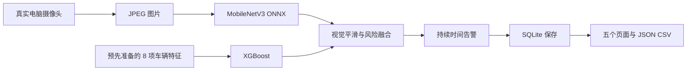

# 我的系统怎么工作：参数、状态、审计与下一步选择

更新：2026-10-12。按实际主仓库代码和浏览器验证解释，不把设计建议当成已实现功能。实机证据见 [09 浏览器验证](09_BROWSER_VERIFICATION_2026-10-12.md)。

## 先回答：我的 live camera inference 成功了吗？

**推理流程成功；当前电脑画面的动作识别效果不合格。** 摄像头的新图片送到了真实 MobileNetV3 模型，结果经过后端融合、保存和页面显示。但诊断中 394 张不同画面全部以 `hair_makeup` 为最高类别，因此“有结果”不能等同于“识别正确”。

`hair_makeup` 中文是“整理头发/化妆”。模型把你的画面误认为这一类，不是系统要求你做这个动作。`FULL` 只说明两路输入新鲜，不表示准确率满分；`1.00` 是模型输出经四舍五入后的概率，不表示现实中一定正确。

同一个模型对 30 张原数据集标注图片输出了全部 10 类，所以不是所有输入都固定 c8。电脑正面画面与训练场景差异是优先调查方向，还需要控制实验确认原因。不要用改权重/改阈值代替修复识别问题。

## 整个系统的一条数据怎么走

前后端确实已经接通，是能运行、保存、查看和导出的完整研究原型。还缺的是部分异常语义、交付复现和规定评估的验收，以及现在已观察到的正面识别问题。原聊天「FYP2分析并优化实时推理系统 (2)」本身也区分了“代码接通”和“实际 camera 识别未验证”。

注意：手势影响 camera；telemetry 的速度、刹车等是预设回放，不来自你的动作或真实汽车。两路来源不同，不要把屏幕上的 74 km/h 理解为电脑正在测你的真实车速。

## 顶部控制与运行信息

| 页面英文 | 中文/作用 | 怎么理解 |
|---|---|---|
| Data mode | 数据模式 | 决定使用真实模型流程还是演示回放 |
| Live trained models | 实时已训练模型 | 真实 camera → MobileNetV3；预设原始车辆特征 → XGBoost |
| Prepared replay demo | 预设回放演示 | 本地演示概率/流程，不是本次真实 camera 识别；与 live 会话分开 |
| Start Monitoring | 开始监测 | 启动 camera 与推理；加载历史后再开始会创建新的实时会话 |
| Pause | 暂停推理 | 停止继续发送；不等于关闭 camera。最后一个在途请求可能已被后端保存 |
| Start Camera / Stop Camera | 开启/关闭摄像头 | 单独控制画面输入；只关 camera 时 telemetry 仍可继续推理 |
| New Session / Restart Session | 新会话/重新开始一个会话 | 建立新的记录组，不删除历史数据 |
| Saved live sessions | 已保存的实时会话 | 加载数据库历史；历史记录不会随着你现在的动作更新 |
| Refresh saved sessions | 刷新保存的会话列表 | 更新可选择的会话及记录数 |
| Session / session_id | 会话编号 | 一次运行的记录组，例如 S 开头的字符串 |
| Window / window_id | 推理记录编号 | live 中一次成功推理一条记录；不是固定“2 秒内 30 帧”的投票窗口 |
| Timestamp | 记录处理时间 | 页面按本地时区显示；export 带 UTC 时区。另有 captured_at 表示采帧时间 |
| Camera: live / idle | 摄像头开启/关闭 | 只表示采集状态，不证明模型识别正确 |
| Camera FPS | 摄像头流配置帧率 | 本次浏览器报告 30.0；不是严格测量所有实际采集帧的吞吐 |
| Inference FPS | 每秒成功推理次数 | 本次约 10；页面按最近最多 20 次请求完成时间计算 |
| target | 目标推理帧率 | 请求调度的目标，性能不够时实际值会更低 |
| Request round trip | 一次请求往返耗时 | 从采帧/编码前到拿到响应；含编码/传输/服务处理，但不含最终页面渲染 |
| Visible history 500 / 811 persisted | 页面可见 500 条，数据库有 811 条 | 页面限制显示最近 500 条，导出仍包含全部 811 条 |
| Loaded model versions / SHA256 | 已加载模型版本指纹 | 确认使用哪个文件；不表示它有多准确 |

判断是否正在运行：`Camera: live`、Inference FPS 有数值、Window 编号和 Timestamp 不断变化。判断是否识别正确：要把动作标签与模型输出对照，不能只看上面的运行指示。

## 风险、概率和告警

| 英文/字段 | 中文含义 | 关键区别 |
|---|---|---|
| Top visual probabilities / visual_top_classes | 10 种视觉类别的概率 | 0–1；0.80 显示成 80%。这是模型对输入图片的分类输出 |
| P_distraction / Visual Distraction | 视觉分心概率 | 原始值是 `1−P(safe_driving)`；live 主分支值经过 EMA 平滑。它不等于 hair_makeup 的概率 |
| P_distraction_raw | 未平滑的视觉分心概率 | 保存在 provenance，便于检查原始模型输出 |
| Telemetry non-safe / P_telemetry_anomaly | 车辆信号非安全行为概率 | `1−P(Safe)`。字段旧名叫 anomaly，实际是监督分类，不是未知异常检测 |
| Safe / Aggressive / Distracted | 安全 / 激进 / 分心驾驶模式 | XGBoost 根据 8 项回放特征的分类，非 camera 的视觉动作标签 |
| RiskScore | 融合风险分数 | 0–100 的设计分数，不是事故发生概率 |
| RiskLevel | 当前分数的等级 | Low 低、Medium 中、High 高，由 30/60 阈值划分 |
| AlertSeverity | 带持续时间的告警级别 | NORMAL 正常、CAUTION 注意、HIGH_ALERT 高告警；与当前瞬时等级可能不同 |
| NORMAL | 没有激活较高告警 | 不能在无证据时直接解释为“安全”；原 unavailable 契约仍待修复 |
| CAUTION | 注意 | 首次 High 时先进入 CAUTION；Medium 也为 CAUTION |
| HIGH_ALERT | 高告警 | High 连续持续至少 2 秒后升级；降为 Low 后通常要连续 10 秒才清除旧告警 |
| Server processing / latency_ms | 服务端处理耗时 | 包含预处理/模型步骤；计时在 DB commit 前结束，不等于完整端到端时延 |
| preprocess_ms / vision_ms / telemetry_ms | 预处理 / 视觉模型 / 车辆模型耗时 | provenance 中分步骤毫秒值，不能把一个模型前向耗时当成总系统耗时 |
| Flag / Unflag | 标记 / 取消标记 | 给记录加书签，方便回看；不改变模型结果或风险分数 |

双方 fresh 且默认权重各 0.5 时：`RiskScore = 100 × (0.5 × P_distraction + 0.5 × P_telemetry_anomaly)`。例如视觉 0.8、车辆 0.2，分数是 50，等级 Medium。如果视觉误判为 1.0，即使车辆为 0，仍会得到 50；融合不能自动消除视觉模型的错误。

视觉 10 类翻译如下。“右/左”指训练类别的驾驶员用手/动作方向，不能仅按镜像预览的屏幕左右理解。

| 编号 | 实际运行标签 | 中文 |
|---|---|---|
| c0 | safe_driving（源数据 normal_driving） | 正常驾驶 |
| c1 | texting_right | 右手发短信/操作手机 |
| c2 | talking_phone_right | 右手持手机通话 |
| c3 | texting_left | 左手发短信/操作手机 |
| c4 | talking_phone_left | 左手持手机通话 |
| c5 | operating_radio | 操作收音机/中控 |
| c6 | drinking | 喝水/饮料 |
| c7 | reaching_behind | 伸手到后方 |
| c8 | hair_makeup | 整理头发/化妆 |
| c9 | talking_to_passenger | 与乘客交谈 |

当前没有驾驶员存在检测或“其他/不认识”视觉类别。模型对空房间、非驾驶背景等输入也必须在这 10 类中分配概率；高概率输出因此不保证画面属于已学过的场景。Inspector 显示完整类别；Explanation 中的 visual cue 会优先从非 safe 类中选一个提示，因此看完整 10 类分布比只看该提示更可靠。

## 健康状态、输入新鲜度与 unavailable

| 状态 | 中文 | 实际含义 |
|---|---|---|
| fresh | 新鲜 | 该路输入存在，时间未超过配置容忍期限 |
| stale | 过期 | 仍有过去的数值，但已经太旧 |
| missing | 缺失 | 本次没有该路输入 |
| FULL | 两路完整 | 两路都 fresh；不是“完全准确” |
| DEGRADED | 降级运行 | 有一路 stale/missing，可能继续依赖另一路；原零有效权重边界仍有缺陷 |
| UNAVAILABLE | 当前无法评估 | 后端双 missing；前端也会在最近记录过期时隐藏当前评估。两者判定层次不同 |
| No current assessment | 没有当前评估 | 保留的结果属于历史，不能用来判断你现在的动作 |
| Feature contribution unavailable | 无特征贡献解释 | 当前没有生成单项 SHAP/归因；不表示 XGBoost 没执行 |

**“unavailable 契约”就是前端、后端、数据库、导出、图表和告警对“没法判断”使用同一个规则。** 例如双路都没输入时，应表达“无法评估”，不能让 API 给 `0 + Low + NORMAL` 而被报告读成“低风险”。现在主页面已经隐藏无效当前分数，但 API/历史/导出仍存在原审计发现的不一致。

建议的后续设计：风险分数/等级允许 `null`，另有 `assessment_available=false`；历史最后有效结果与当前可用性分开表达；告警是否保留旧状态另行明确。只有一条可用且具有正有效权重的证据时，才继续输出 DEGRADED 的风险。这是建议，**本次未改 API 或实现它**。

新鲜度参与融合：fresh 系数 1，stale 0.45，missing 0。权重先乘对应系数，再除以剩余有效权重之和。例如 camera missing、telemetry fresh 且 telemetry 权重 >0，分数完全由 telemetry 给出，不是自动减半。如果两边有效权重都为零，应该无法评估；目前返回 0 是待修复缺口。

## Configuration：可以调的参数

| 参数 | 默认 | 用途与变化 |
|---|---|---|
| Target inference FPS / inferenceFps | 10，范围 1–30 | 每秒目标请求数；调大增加计算压力，不提升单帧识别能力。一次仅一个请求在途，不积压旧画面 |
| Vision Weight / weight_vision | 0.50 | 视觉结果在融合中的设计权重 |
| Telemetry Weight / weight_telemetry | 0.50 | 车辆结果的设计权重；调整其中一个会补齐另一个，总和必须 1 |
| Low / Medium Threshold / threshold_low | 30 | 分数 <30 是 Low；从 30 起为 Medium |
| Medium / High Threshold / threshold_high | 60 | 分数 ≥60 是 High；30≤分数<60 为 Medium |
| Export JSON | — | 全会话结构化导出，便于程序分析；包含模型、来源、配置、输入和结果 |
| Export CSV | — | 全会话表格导出；嵌套概率/来源字段使用 JSON 字符串 |

这些参数是系统设计值，不是已经通过真实驾驶验证的安全标准。改变设置会暂停监测，下次开始用新配置建立新会话；历史会话保留当时配置。

代码中的其他参数/规则（不是全部都能在页面调）：

| 参数/规则 | 当前值 | 中文解释 |
|---|---|---|
| ema_alpha | 0.35 | 新视觉分心值占 35%，上一平滑值占 65%；减小会更平滑，也更迟钝。类别概率本身没有这种 EMA |
| freshness_tolerance_s | 3 秒 | 超过该输入年龄为 stale；前端也用它区分当前与历史结果。后端尚无 stale 最长可用年龄 |
| 高风险持续门槛 | 2 秒 | 控制告警升级，不能当作模型处理时延 |
| 低风险恢复门槛 | 10 秒 | 避免刚转 Low 就立刻清除旧高告警；Medium 会转 CAUTION 并重置高风险连续计时 |
| EVIDENCE_GAP | 0.15 | 两分支概率差小于它时标为 Combined evidence，不是分类置信度门槛 |
| Relative Evidence 平衡界限 | 0.03 | 两分支概率差小于它时显示 balanced；与上面的主证据类型规则用途不同 |
| deltaT / prepared telemetry cadence | 2 秒 | 演示步长/车辆特征回放步长；live 请求仍约 10 次/秒，没有 30 帧多数投票 |
| camera 理想尺寸/帧率 | 640×480 / 30 FPS | 浏览器采集请求；实际要看设备返回值 |
| JPEG quality | 0.85 | 发往本机服务的帧编码质量；不是识别置信度 |
| 模型输入 | RGB、224×224、NCHW float32 | 图片按训练验证方式处理；RGB 不是 OpenCV 的 BGR |
| mean / std | [0.485,0.456,0.406] / [0.229,0.224,0.225] | 图像归一化值，训练与运行一致 |
| inference_threads | 2 | ONNX/XGBoost CPU 计算线程配置，不是并行推理帧数 |
| request timeout | 10 秒；初始化 15 秒 | 请求超时控制，不是正常性能目标 |
| 失败退避 | 指数增加，单次等待上限 10 秒 | 当前其他错误无最大次数；404/409/422/503 会停止。有限 3 次方案只是建议 |
| 断流清理 | 超过 3 秒间隔 | 清除旧视觉 EMA/连续告警计时，避免旧证据继续构成新连续事件 |

## Telemetry：8 个车辆输入

这些值来自预设场景。模型输入要求与训练特征顺序/语义一致，不能随意换单位。页面已有部分单位标签，但 brake/throttle/lane 的完整物理单位、范围契约仍待统一（原审计 D04）。

| 字段 / 页面 | 中文 | 现有界面含义 |
|---|---|---|
| speed_kmph / Speed | 车速 | km/h |
| accel_x / Accel X / Longitudinal Accel | 纵向加速度 | 沿行驶方向的加减速，m/s²；不要与横向加速度混淆 |
| accel_y / Accel Y / Lateral Accel | 横向加速度 | 横向/转弯方向的变化，m/s² |
| brake_pressure / Brake pressure / Braking | 制动输入 | Live 卡片用百分比展示；Inspector 仅显示原数值，不能擅自认定为 bar/Pa |
| steering_angle / Steering | 方向盘/转向角 | 度；界面负值解释为 left，正值为 right |
| throttle / Throttle | 油门输入 | Live 卡片用百分比展示；正式物理单位/边界仍需与合成数据定义核对 |
| lane_deviation / Lane position | 车道偏移 | Live 卡片按离中心多少米展示；Inspector 显示原值，正式定义仍待统一 |
| headway_distance / Headway / Following distance | 跟车距离 | 米，前方车辆距离 |

LOW/MODERATE、GENTLE/FIRM、LIGHT/HEAVY、CENTRED/OFF-CENTRE、TOO CLOSE 等是这些数值的页面描述，不是新增传感器或额外模型输出。

## Evidence：系统为什么显示这个分数

| 英文 | 中文 | 解释 |
|---|---|---|
| DominantEvidence / Evidence Type | 主要证据类型 | 根据分支可用性、概率差和分数，套用可检查的规则 |
| Vision-dominant | 视觉证据较强 | 视觉分心概率明显高于车辆非安全概率 |
| Telemetry-dominant | 车辆证据较强 | 车辆非安全概率明显较高 |
| Combined evidence | 两路共同证据 | 概率差 <0.15；不代表已经证明融合提升了真实准确率 |
| Partial evidence | 部分证据 | 系统不是 FULL |
| Low observed risk | 已观察证据下的低分 | FULL 且分数低于 30；应与“没有证据”分开 |
| Relative Evidence | 两路强弱关系 | 比较概率数值，非因果解释 |
| Vision/Telemetry contribution | 视觉/车辆对分数的贡献 | 有效权重乘分支概率后得到的分数点数；不是 SHAP |
| Telemetry Feature contribution | 单个车辆特征的归因 | 当前 live 未生成，显示 unavailable，不伪造贡献值 |
| provenance | 结果来源与追溯记录 | 请求 ID、来源、model hash、采帧/处理时间、原始概率、融合配置 |
| request_id | 推理请求标识 | 用于追溯和重复请求去重；不等于 session_id |

## 五个页面各看什么

| 页面 | 中文 | 最适合做什么 |
|---|---|---|
| Live Monitor | 实时监控 | 看画面、当前分数、采集/推理状态及输入缺失 |
| Signal Inspector | 信号检查 | 选一条记录，看 10 类概率、8 特征、分数/时间/flag |
| Risk Trends | 风险趋势 | 看所加载记录的时间变化；部分历史可见，不是完整导出条数 |
| Explanation | 解释 | 看两分支如何影响分数、证据规则、可用/缺失的解释 |
| Configuration | 配置 | 看目标 FPS、权重、阈值及全量导出 |

暂停后这几个页面保留历史。上方 `No current assessment` 与 Inspector 的旧记录 `fresh` 可以同时出现：后者是保存当时的新鲜度，前者是现在没有新结果。

## audit 是什么？02 文档写的是什么？

audit 是“项目体检”：检查真实仓库里有哪些功能、哪些测试真正运行过、什么证据足以支持毕业项目的结论。它不会因为列了缺口，就否认你已经做完的前后端。

`Top 10 blockers / gaps` 把实际代码问题、缺实验、缺交付证据放在一起，不能读成“10 个功能都没写”。例如 B01/B02 是数据语义问题，B04 是验证证据不足，B05 原先涉及未提交代码/模型分发；现在代码已冻结、真实浏览器证据已补，仍需看 [09 更新表](09_BROWSER_VERIFICATION_2026-10-12.md)。

[02_TEST_CASE_INVENTORY_AND_CRITIQUE.md](02_TEST_CASE_INVENTORY_AND_CRITIQUE.md) 做两件事：逐项整理已有 60 个自动测试；检查它们是否真的能证明规范要求。表中包括输入、步骤、预期结果（oracle）、实际状态、质量评价、缺口和优先级。后面建议的新测试标为 PLANNED，不能当成已运行通过。

例如一个测试断言“双输入缺失时分数等于 0”，执行可以通过，但这个预期本身与“无证据应不可评估”的验收要求冲突。**绿色测试 = 程序符合该断言；不自动等于产品行为合理或识别准确。**

| 缩写/状态 | 中文 |
|---|---|
| UT / Unit | 单元测试：一个公式/函数/状态转换 |
| IT / Integration | 集成测试：模块、API、数据库连起来 |
| ST / System | 系统测试：完整浏览器到服务流程 |
| PERF | 性能：延迟、吞吐、持续运行等 |
| UAT | 用户验收：真实参与者完成规定任务 |
| CURRENT_VERIFIED | 本次确有检查证据，范围以记录为准 |
| PARTIALLY_VERIFIED | 只验证了一部分 |
| MISSING_TEST / NOT_FOUND | 尚无所需测试/未在扫描范围找到证据 |
| PLANNED | 已提出，尚未执行 |
| SOUND / SOUND_WITH_RESTRICTIONS | 方法合理 / 需限定适用范围 |
| NEEDS_REDRAFT / INVALID | 需要修改测试设计 / 不适合作为该项验收依据 |

## evaluation 与“任务 3”

这里的 **evaluation 是评估**；evolution 才是演化。评估的意思是“用什么实验和证据证明系统符合要求”，不是把已完成系统重新做一遍。

如果你指 `03_EVALUATION_COVERAGE_MATRIX.md`，它是第三份覆盖表；如果你指 E3，它是第三类评估。二者不能混成一个新增开发任务。

| 评估 | 用容易理解的话说 |
|---|---|
| E1 | 单个模型遇到变暗、模糊、遮挡、车辆输入噪声/缺失等时是否可靠 |
| E2 | 输入正常时，单路和融合输出是否按规则工作，证据是否互补 |
| E3 | camera/telemetry 过期或缺失时，权重、分数、可用性是否正确处理 |
| E4 | 长时间运行、短暂高分、故障/重试、暂停恢复是否稳定 |
| E5 | 一路受到干扰而另一路保持正常时，比较单路与融合；不能只凭融合波动小就宣称更安全 |

源数据分类准确率、camera 正面标注评估、性能和 UAT 也需要独立记录。当前 camera 问题说明完整软件链路与识别质量验收是两件都必须完成的工作。

## 当前工作树怎么用？怎么选择 Claude Code 的四个决定？

当前 Codex 工作树从旧提交 `ae55041` 创建，用于保存这次审计文档；桌面主仓库的 `dev_cc` 才有最新 live 系统。它们是同一个 Git 仓库的独立文件目录，文件修改不会自动同步。不要在这个旧树运行程序，再把看到的旧行为当成桌面最新系统。

主仓库已把 runtime、测试、前端和原审计分八个提交保存，验证时 HEAD 为 `845b43a`。本次只将新增文档/证据同步并提交到 dev_cc，保留其他任务的未提交改动；未合并 Claude 独立工作树。

针对截图里的四项，建议如下，**没有替你在 Claude 中提交答案或实现这些方案**：

1. **D01：选 nullable 分数/等级 + 明确 availability。** “没法判断”不要写成 0/Low；API、UI、DB、CSV/JSON、图表一致，并单独标识最后有效历史告警。
2. **本轮范围：先完成 A01–A05/P0 的系统补齐。** 先处理不可用语义、故障恢复、浏览器/持久化和交付；模型对比/HPO 放在之后的明确阶段。新发现的 camera 识别问题应进入后续目标视角验证，不把现有源准确率当作它已经通过。
3. **D02：推荐连续 3 次可重试请求失败后停止 + 手动重试 + 持久 fault 记录。** 3 次指失败的推理请求，不是 3 个视频帧；一次成功清零连续计数。坏输入/配置立即停，暂时网络等错误才重试。故障原因、耗尽状态可见；DB 本身故障时需独立日志去向；响应丢失后的重复发送使用原 request ID 去重。当前“所有 503 停止”的规则与未来永久/暂时故障分类也要明确对齐。这个 N=3 是新建议，不是已经实现的事实。
4. **55 个未提交文件：先冻结并提交当前 dev_cc，再继续开发。** baseline 已由其他任务完成八个提交；不把这些已提交代码重新合并到旧树，也不把 Claude 工作树未经检查的改动全部覆盖进来。模型分发仍单独解决。

实机诊断后摄像头已停止；本机验证服务恢复原应用并保留数值记录。后续 camera 的根因验证/开发应另按这次发现安排，本轮没有训练或改应用行为。
